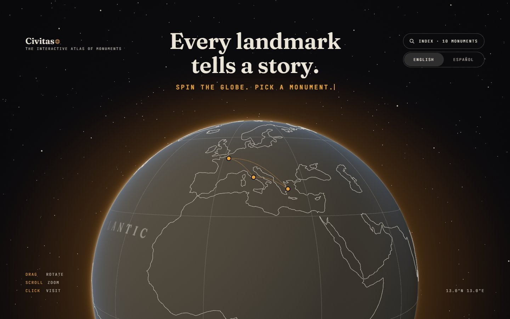
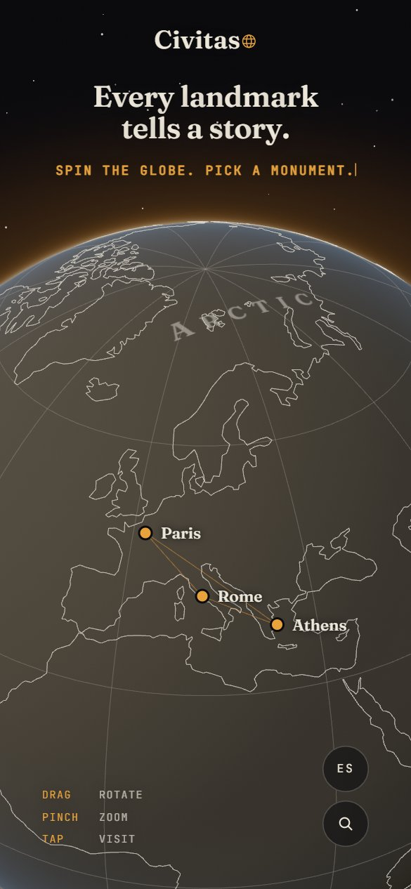
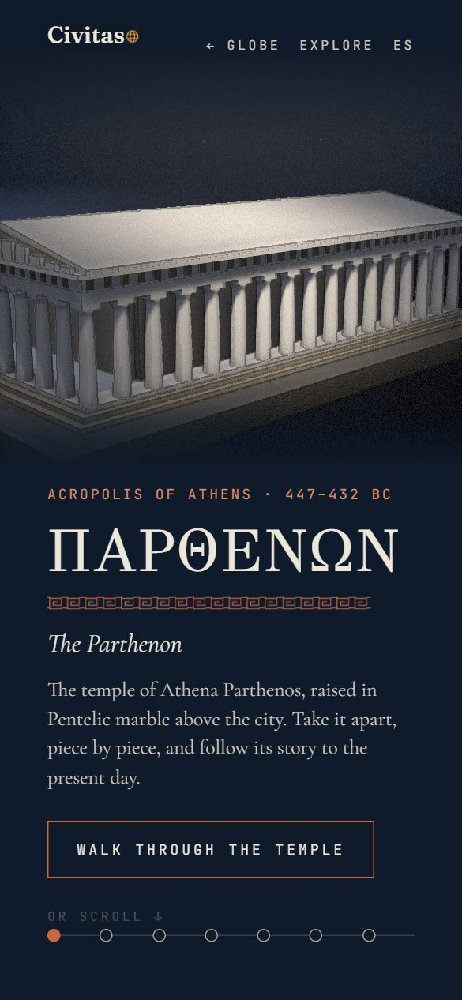
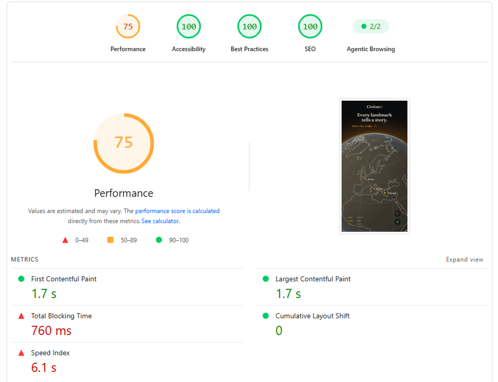
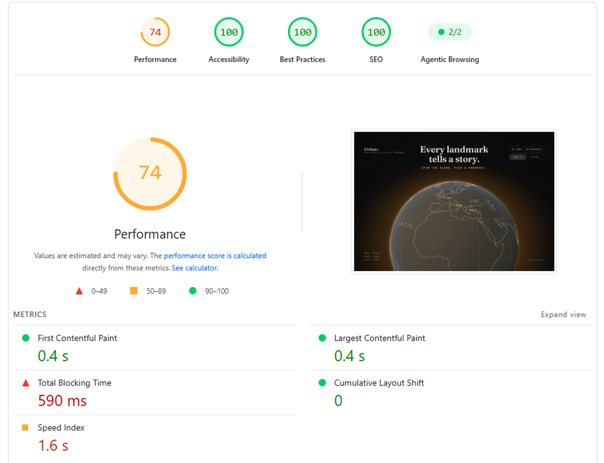

<div align="center">

# Civitas · The interactive atlas of monuments

**Every landmark tells a story.**
Spin a globe, pick a monument and scroll through its history while its scale model assembles, falls apart and changes shape in front of you.

[**Visit visitcivitas.com →**](https://visitcivitas.com)

<br />



</div>

## Overview

A visual wiki of world monuments. The home page is a 3D globe: click a landmark and the camera flies down into its page, where the monument is a **museum maquette under a single spotlight** and its story (quarry, construction, disasters, restorations) plays out as you scroll. At the end, **Explore** lets you orbit the model, switch historical views and open a card for each piece. In English and Spanish.

<table>
  <tr>
    <td align="center" width="25%"><br /><sub>The globe</sub></td>
    <td align="center" width="25%"><br /><sub>Athens</sub></td>
    <td align="center" width="25%"><br /><sub>Rome</sub></td>
    <td align="center" width="25%"><br /><sub>Paris</sub></td>
  </tr>
</table>

## How it's built

**Astro 5** (static + one serverless route) · **Three.js** with a custom render pipeline · **GSAP** ScrollTrigger · **Vue 3** island + nanostores · Sass · TypeScript · Vitest + Playwright · Umami · Vercel. Architecture: [docs/PLAN.md](docs/PLAN.md#arquitectura) *(Spanish)*.

- **Every model is code.** No imported meshes: Three.js primitives with real proportions and `InstancedMesh` for anything repeated, within a budget of ~10–20 draw calls per model.
- **One look for everything.** A G-buffer for ambient occlusion and ink outlines, then a plaster pass with grain and vignette.
- **Scroll drives the story.** Each chapter maps to a camera pose and a model state, so scrolling takes the monument apart and puts it back together.
- **Monuments load before you click.** Hovering a city starts loading it; scenes follow `load → warm → activate → sleep → dispose`, with shaders compiled off screen and GPU memory released on exit.
- **Render on demand** with static shadows, and an **adaptive quality governor** that drops or raises the tier from real frame times.
- **Built for phones.** Tested on an iPhone 15 in Low Power Mode, `100lvh` canvas so the iOS toolbar never shifts the hotspots, and without WebGL the story still reads as text.

### Measured

Live site, Chrome on Intel integrated graphics, 1440 × 900, cold cache, median of 3 runs; *CPU 4×* stands in for a mid-range phone.

| Page | Ready | FPS | Ready (CPU 4×) | FPS (CPU 4×) | Draw calls / frame |
| :-- | --: | --: | --: | --: | --: |
| Hub (globe) | 0.9 s | 144 | 1.3 s | 138 | 17 |
| Athens | 1.0 s | 144 | 2.0 s | 139 | 24 |
| Rome | 1.1 s | 136 | 2.0 s | 118 | 33 |
| Paris | 1.1 s | 136 | 1.9 s | 136 | 12 |

*Ready* = navigation to first rendered scene; 144 fps is the monitor's limit; no frame over 50 ms. ~210–260 KB of gzipped JS per page.

## PageSpeed

PageSpeed Insights on [visitcivitas.com](https://visitcivitas.com), before and after applying my SEO workflow:

<table>
  <tr>
    <th width="50%">Mobile</th>
    <th width="50%">Desktop</th>
  </tr>
  <tr>
    <td></td>
    <td></td>
  </tr>
  <tr>
    <td colspan="2" align="center"><sub><b>Before</b> · November 5, 2026</sub></td>
  </tr>
  <tr>
    <td></td>
    <td></td>
  </tr>
  <tr>
    <td colspan="2" align="center"><sub><b>After</b> · November 6, 2026</sub></td>
  </tr>
</table>

**Why the performance score was stuck: PageSpeed has no GPU.** Lighthouse runs on servers without a graphics card, so WebGL falls back to SwiftShader and every frame of the globe is drawn on the CPU (~90 ms each). The intro and the ambient motion (spin, twinkling stars) kept asking for frames, and each one counted as main-thread blocking: 2,400 ms of Total Blocking Time on mobile.

The fix is not aimed at the test. The engine already read the WebGL renderer name to pick a quality tier; now, when it reports a software renderer (SwiftShader, llvmpipe and the like), the globe also behaves as it does with *reduce motion*: it appears settled, without the intro or ambient animation, and only draws again when the visitor touches it. A real computer with hardware acceleration turned off, a blocklisted GPU driver or a virtual machine is in the same situation, and there those frames were burning the CPU and the battery. Visitors with a GPU see no change.

| PageSpeed | Before | After |
|---|---|---|
| Performance (mobile / desktop) | 65 / 60 | **75 / 74** |
| Accessibility (mobile / desktop) | 88 / 95 | **100 / 100** |
| Total Blocking Time (mobile) | 1,830 ms | **760 ms** |

What is left of the blocking time is the one-off cost of creating the WebGL context and compiling the shaders.

## Also inside

- **Suggest a monument:** one serverless function verifies Cloudflare Turnstile and appends to a Google Sheet, signing the service-account JWT with Web Crypto (no `googleapis`).
- **Two languages:** English at the root and Spanish under `/es`, with `hreflang` and both versions in the sitemap. The home page sends visitors from Spain and Latin America to `/es`; the **English | Español** switch overrides it.
- **Analytics:** cookieless Umami with events for city opens, chapters reached, Explore views, pieces opened and suggestions.
- **Adding a monument** follows one checklist (identity, fact-checked brief, model, both languages, then SEO) in [docs/ART-DIRECTION.md §7](docs/ART-DIRECTION.md) *(Spanish)*.

## Development

Requires Node 20 or later.

```sh
npm install
npm run dev       # local server at http://localhost:4321
npm run check     # astro check (types)
npm test          # vitest
npm run build     # builds the site into ./dist/
npm run preview   # serves the build locally
```

Only **Suggest a monument** needs config: copy `.env.example` to `.env.local` ([Turnstile test keys](https://developers.cloudflare.com/turnstile/troubleshooting/testing/) work on `localhost`). Also: `npm run smoke`, `npm run og`, `npm run build:globe-data`.

## Author

Jesús Ahumada — [Portfolio](https://jesusgabriel.dev/) · [LinkedIn](https://www.linkedin.com/in/jesus-ahumada) · [GitHub](https://github.com/jesusgabri3l)

## License

[MIT](LICENSE) © 2026 Jesús Ahumada
