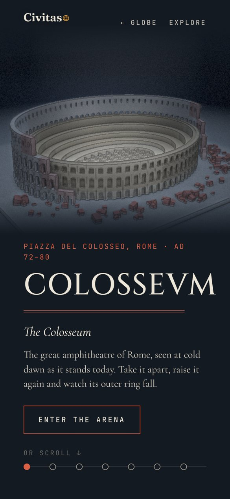
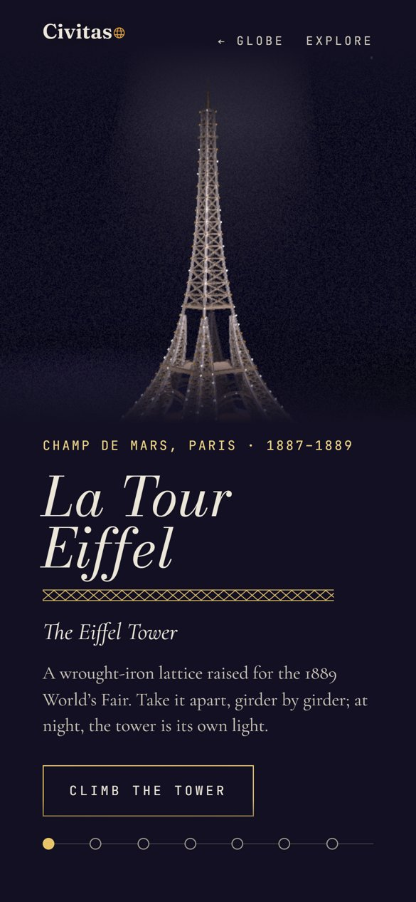

<div align="center">

# Civitas · The interactive atlas of monuments

**Every landmark tells a story.**
Spin a globe, pick a monument and scroll through its history while its scale model assembles, falls apart and changes shape in front of you.

[**Visit visitcivitas.com →**](https://visitcivitas.com)

<br />


</div>

## Overview

Civitas is a visual wiki of world monuments. The home page is a 3D globe: every hotspot is a landmark, and clicking one flies the camera down into its page. Each monument is shown as a **museum maquette under a single spotlight**, and its story is told in chapters tied to the scroll: the quarry, the construction, the disasters, the restorations, and an **Explore** mode at the end to orbit the model, switch between historical views and open a card for each piece.


### On a phone

<table>
  <tr>
    <td align="center" width="25%"><br /><sub>The globe</sub></td>
    <td align="center" width="25%"><br /><sub>Athens</sub></td>
    <td align="center" width="25%"><br /><sub>Rome</sub></td>
    <td align="center" width="25%"><br /><sub>Paris</sub></td>
  </tr>
</table>

## Art direction

**One night, one light per city.** Civitas has two layers:

| Layer | What it owns | Changes per city |
| :-- | :-- | :-- |
| **Civitas** (the hub) | Logo, navigation, timeline, coordinates, museum cards, page structure, plaster models, dark background | Never |
| **The city** | Title typeface, accent color, background tint, decorative motif, light and atmosphere, one shareable "moment" | Always |

Rule of thumb: *if it is navigation or data, it belongs to Civitas; if it is emotion or place, it belongs to the city.* The visitor should feel they changed places, never that they changed websites.

<table>
  <tr>
    <td align="center" width="50%"><br /><sub>Athens · GFS Didot, night blue, terracotta, Greek key</sub></td>
    <td align="center" width="50%"><br /><sub>Paris · Bodoni Moda italic, violet night, champagne, lattice</sub></td>
  </tr>
</table>

The full system (tokens, page template, 3D rules and the checklist for adding a monument) lives in [docs/ART-DIRECTION.md](docs/ART-DIRECTION.md) *(Spanish)*.

## Stack

| | |
| :-- | :-- |
| Framework | [Astro 5](https://astro.build) (static, one serverless route) |
| 3D | [Three.js](https://threejs.org) r170 with a custom render pipeline |
| Animation | [GSAP](https://gsap.com) + ScrollTrigger |
| UI | Vue 3 island for the hub overlay, nanostores for state |
| Styles | Sass (7-1 pattern) |
| Language | TypeScript |
| Tests | Vitest + a Playwright smoke test |
| Analytics | [Umami](https://umami.is) (cookieless) |
| Hosting | Vercel, auto-deploy on every push to `main` |

Project structure and architecture: [docs/PLAN.md](docs/PLAN.md#arquitectura) *(Spanish)*.

## How the 3D works

- **Every model is code.** No imported meshes or scanned textures: each monument is built from Three.js primitives with real proportions, using `InstancedMesh` for anything repeated (columns, arches, girders).
- **One look for everything.** A custom pipeline renders the scene, a G-buffer for ambient occlusion and ink outlines, and a final plaster pass with grain and vignette.
- **Scroll drives the story.** GSAP ScrollTrigger maps each chapter to a camera pose and a model state, so scrolling literally takes the monument apart and puts it back together.
- **Globe ↔ city trips.** The camera dives into the globe and a circular reveal fades into the city's own color. Navigation is client-side, but every route is also prerendered for SEO and direct links.

## Engineering for performance

A real-time 3D site lives or dies on its frame budget, so performance was designed in from the start, not patched at the end.

**Loading and preloading**
- **Monuments load before you click.** Opening a city's tooltip on the globe, or resting 200 ms on its row in the index, starts loading that monument, so the trip usually begins with the scene already prepared off screen.
- **Each scene has a lifecycle:** `load → warm → activate → sleep → dispose`. Shaders are compiled during the warm-up, so the first frame never stutters, and scenes you leave release their GPU memory.
- **Models are built in parts.** Model construction is async and yields to the main thread between groups of pieces, so hover, the index and scrolling stay responsive while a monument is built.

**Rendering**
- **Render on demand.** Nothing is drawn when nothing moves, and shadows are static, redrawn only when the model changes.
- **Instancing and a draw-call budget** of about 10–20 calls per model; procedural textures are generated once, cached and shared between cities; the G-buffer uses half floats.

**Adaptive quality**
- Three tiers (`low`, `medium`, `high`) control shadows, MSAA, dust and pixel ratio. A governor watches real frame times: it drops a tier after ~2 s under 28 fps, jumps straight to `low` under 10 fps, and climbs back only after ~8 s above 55 fps, never above the tier detected for the device.
- Software WebGL starts on `low`, the pixel ratio is adjusted when you change monitor or zoom, and **without WebGL the story still reads as plain text**.

### Built for phones

- Tested on a real iPhone 15, including **Low Power Mode**: Safari caps it at 30 fps, and the governor recognizes that cap instead of downgrading the scene.
- The canvas uses large-viewport units (`100lvh`), so the iOS toolbar showing or hiding never shifts the globe hotspots.
- Atmospheric gradients (like Rome's mist) are drawn in shaders, because canvas textures left visible blotches on iOS.
- Touch-first UI: inputs at 16 px to avoid iOS auto-zoom, no autofocus on touch screens, and *back* goes straight to the globe.

### Measured

Live site, Chrome on Intel integrated graphics, 1440 × 900, cold cache, median of 3 runs. The second set of columns repeats the test with the CPU slowed down 4× as a stand-in for a mid-range phone.

| Page | Ready | FPS | Ready (CPU 4×) | FPS (CPU 4×) | Draw calls / frame |
| :-- | --: | --: | --: | --: | --: |
| Hub (globe) | 0.9 s | 144 | 1.3 s | 138 | 17 |
| Athens | 1.0 s | 144 | 2.0 s | 139 | 24 |
| Rome | 1.1 s | 136 | 2.0 s | 118 | 33 |
| Paris | 1.1 s | 136 | 1.9 s | 136 | 12 |

*Ready* is from navigation to the first rendered scene. *FPS* counts frames actually rendered by the engine while dragging the globe or scrolling the story (144 is the monitor's limit); no run had a frame over 50 ms. Draw calls include every pass (scene, G-buffer and plaster). JavaScript per page: ~210–260 KB gzipped.

## Suggest a monument

Visitors can propose the next landmark from the index. To avoid running a full backend, the form posts to a **single serverless function** (`/api/suggest`, the only non-prerendered route on Vercel), which:

1. Verifies a **Cloudflare Turnstile** token (no CAPTCHA puzzles for real people).
2. Validates and sanitizes the fields.
3. Appends a row to a **Google Sheet** through a service account, signing the JWT with Web Crypto (no `googleapis` dependency).

## PageSpeed

PageSpeed Insights on [visitcivitas.com](https://visitcivitas.com), before applying my SEO workflow:

<table>
  <tr>
    <th width="50%">Mobile</th>
    <th width="50%">Desktop</th>
  </tr>
  <tr>
    <td></td>
    <td></td>
  </tr>
  <tr>
    <td colspan="2" align="center"><sub><b>Before</b> · November 5, 2026 · <b>After</b>: coming soon</sub></td>
  </tr>
</table>

## Analytics

Umami runs only in production (`src/state/track.ts`). Besides page views, it receives:

| Event | When it fires |
| :-- | :-- |
| `city_open` | A monument opens, with `from`: `globe`, `index` or `url` |
| `chapter_reached` | First time a visitor reaches each chapter |
| `explore_view` | A historical view is picked in Explore |
| `piece_open` | A piece of the model is clicked to open its card |
| `suggest_sent` | A monument suggestion is sent |

## Adding a monument

The atlas keeps growing. Every new monument follows the same checklist: propose two or three identities (typeface, color, motif, moment), write and fact-check a brief, build the model and its chapters, and only then add its SEO. The checklist is in [docs/ART-DIRECTION.md §7](docs/ART-DIRECTION.md) *(Spanish)*, and new pages are indexed in the search automatically from the city registry.

## Development

Requires Node 20 or later.

```sh
npm install
npm run dev       # local server at http://localhost:4321
npm run check     # astro check (types)
npm test          # vitest
npm run build     # builds the site into ./dist/
npm run preview   # serves the build locally
```

Everything except **Suggest a monument** works without configuration. For the form, copy `.env.example` to `.env.local` and fill in the Google service account; Cloudflare's [Turnstile test keys](https://developers.cloudflare.com/turnstile/troubleshooting/testing/) work on `localhost`.

Other scripts: `npm run smoke` (headless Playwright smoke test, after a build), `npm run og` (regenerates the Open Graph images) and `npm run build:globe-data` (regenerates the globe coastlines from Natural Earth).

## Author

Jesús Ahumada — [Portfolio](https://jesusgabriel.dev/) · [LinkedIn](https://www.linkedin.com/in/jesus-ahumada) · [GitHub](https://github.com/jesusgabri3l)

## License

[MIT](LICENSE) © 2026 Jesús Ahumada
