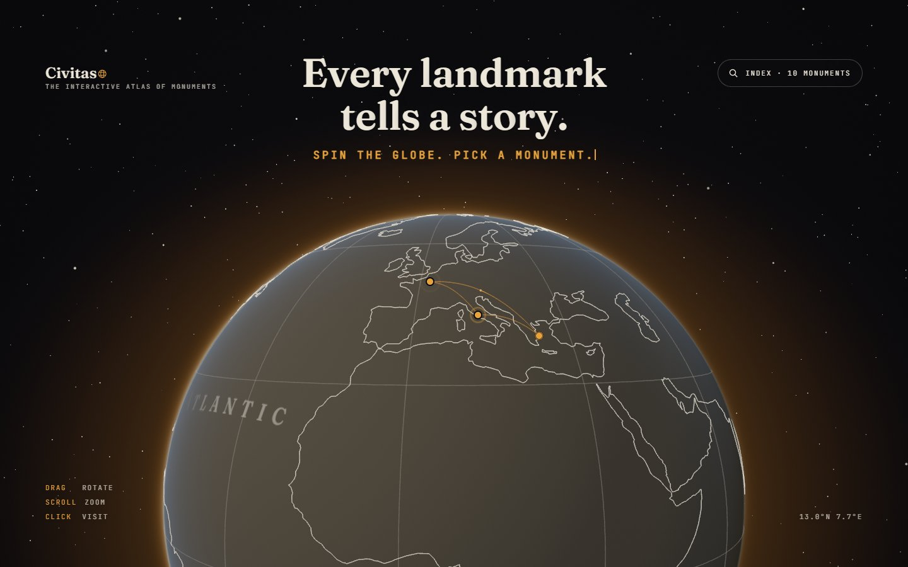
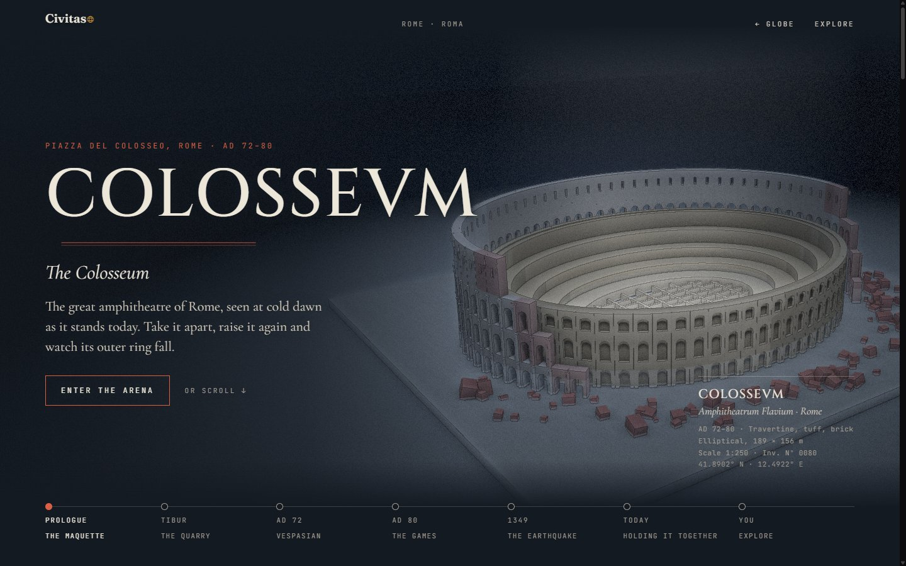
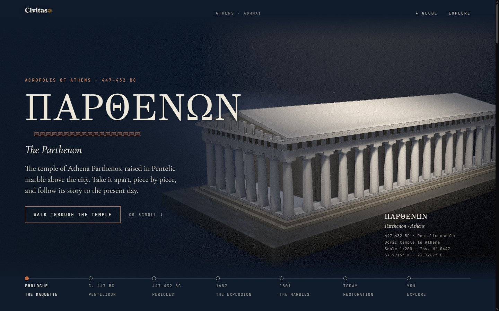
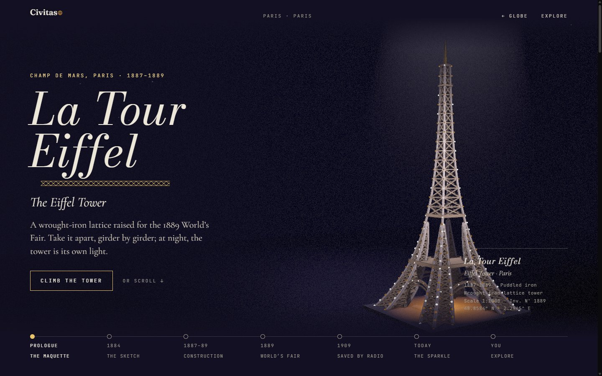
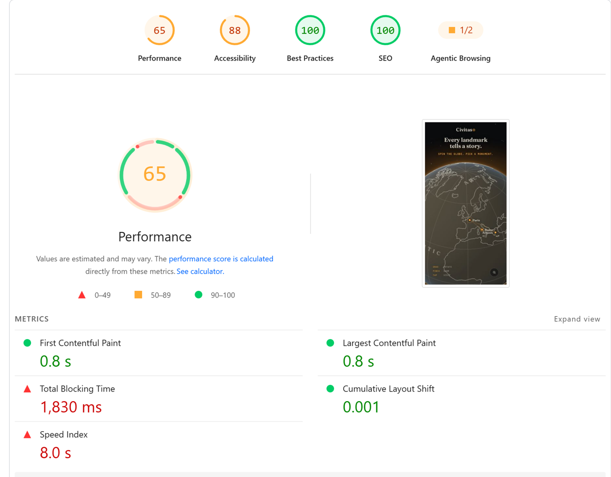
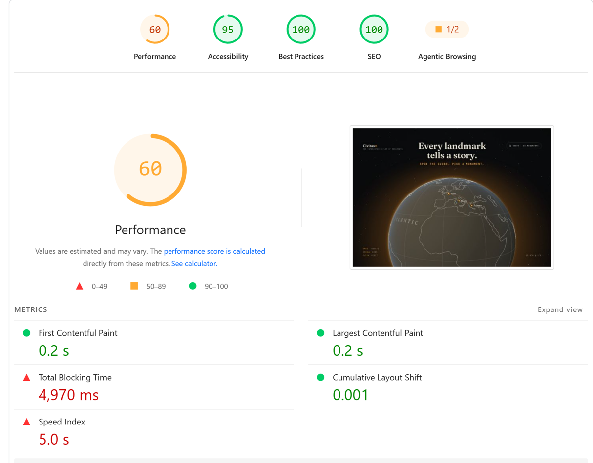

<div align="center">

# Civitas · The interactive atlas of monuments

**Every landmark tells a story.**
Spin a globe, pick a monument and scroll through its history while its scale model assembles, falls apart and changes shape in front of you.

[**Visit visitcivitas.com →**](https://visitcivitas.com)

<br />



</div>

## Overview

Civitas is a visual wiki of world monuments. The home page is a 3D globe: every hotspot is a landmark, and clicking one flies the camera down into its page. Each monument is shown as a **museum maquette under a single spotlight**, and its story is told in chapters tied to the scroll: the quarry, the construction, the disasters, the restorations, and an **Explore** mode at the end to orbit the model, switch between historical views and open a card for each piece.



## Art direction

**One night, one light per city.** Civitas has two layers:

| Layer | What it owns | Changes per city |
| :-- | :-- | :-- |
| **Civitas** (the hub) | Logo, navigation, timeline, coordinates, museum cards, page structure, plaster models, dark background | Never |
| **The city** | Title typeface, accent color, background tint, decorative motif, light and atmosphere, one shareable "moment" | Always |

Rule of thumb: *if it is navigation or data, it belongs to Civitas; if it is emotion or place, it belongs to the city.* The visitor should feel they changed places, never that they changed websites.

<table>
  <tr>
    <td align="center" width="50%"><br /><sub>Athens · GFS Didot, night blue, terracotta, Greek key</sub></td>
    <td align="center" width="50%"><br /><sub>Paris · Bodoni Moda italic, violet night, champagne, lattice</sub></td>
  </tr>
</table>

The full system (tokens, page template, 3D rules and the checklist for adding a monument) lives in [docs/ART-DIRECTION.md](docs/ART-DIRECTION.md) *(Spanish)*.

## Stack

| | |
| :-- | :-- |
| Framework | [Astro 5](https://astro.build) (static, one serverless route) |
| 3D | [Three.js](https://threejs.org) r170 with a custom render pipeline |
| Animation | [GSAP](https://gsap.com) + ScrollTrigger |
| UI | Vue 3 island for the hub overlay, nanostores for state |
| Styles | Sass (7-1 pattern) |
| Language | TypeScript |
| Tests | Vitest + a Playwright smoke test |
| Analytics | [Umami](https://umami.is) (cookieless) |
| Hosting | Vercel, auto-deploy on every push to `main` |

Project structure and architecture: [docs/PLAN.md](docs/PLAN.md#arquitectura) *(Spanish)*.

## How the 3D works

- **Every model is code.** No imported meshes or scanned textures: each monument is built from Three.js primitives with real proportions, using `InstancedMesh` for anything repeated (columns, arches, girders).
- **One look for everything.** A custom pipeline renders the scene, a G-buffer for ambient occlusion and ink outlines, and a final plaster pass with grain and vignette.
- **Scroll drives the story.** GSAP ScrollTrigger maps each chapter to a camera pose and a model state, so scrolling literally takes the monument apart and puts it back together.
- **Globe ↔ city trips.** The camera dives into the globe and a circular reveal fades into the city's own color; the next city is prepared off screen before the dive.
- **Adaptive quality.** Rendering is on demand, and a governor drops or raises the quality tier (shadows, MSAA, pixel ratio) based on real frame times. Without WebGL, the story still reads as plain text.

## Suggest a monument

Visitors can propose the next landmark from the index. To avoid running a full backend, the form posts to a **single serverless function** (`/api/suggest`, the only non-prerendered route on Vercel), which:

1. Verifies a **Cloudflare Turnstile** token (no CAPTCHA puzzles for real people).
2. Validates and sanitizes the fields.
3. Appends a row to a **Google Sheet** through a service account, signing the JWT with Web Crypto (no `googleapis` dependency).

## Performance

PageSpeed Insights on [visitcivitas.com](https://visitcivitas.com), before applying my SEO workflow:

<table>
  <tr>
    <th width="50%">Mobile</th>
    <th width="50%">Desktop</th>
  </tr>
  <tr>
    <td></td>
    <td></td>
  </tr>
  <tr>
    <td colspan="2" align="center"><sub><b>Before</b> · November 5, 2026 · <b>After</b>: coming soon</sub></td>
  </tr>
</table>

## 3D performance

Measured on the live site in Chrome, 1440 × 900, Intel integrated graphics (`high` tier):

| Page | Ready in | Draw calls / frame | Triangles / frame | FPS while scrolling |
| :-- | --: | --: | --: | --: |
| Hub (globe) | 3.0 s | 17 | 15 k | 144 |
| Athens | 1.0 s | 24 | 76 k | 140 |
| Rome | 1.0 s | 33 | 147 k | 123 |
| Paris | 0.8 s | 12 | 41 k | 144 |

Draw calls and triangles count every pass (scene, G-buffer and plaster). "Ready in" is from navigation to the first rendered scene. JavaScript (gzip): ~213 KB on the hub, ~250 KB on a monument page.

## Analytics

Umami runs only in production (`src/state/track.ts`). Besides page views, it receives:

| Event | When it fires |
| :-- | :-- |
| `city_open` | A monument opens, with `from`: `globe`, `index` or `url` |
| `chapter_reached` | First time a visitor reaches each chapter |
| `explore_view` | A historical view is picked in Explore |
| `piece_open` | A piece of the model is clicked to open its card |
| `suggest_sent` | A monument suggestion is sent |

## Development

Requires Node 20 or later.

```sh
npm install
npm run dev       # local server at http://localhost:4321
npm run check     # astro check (types)
npm test          # vitest
npm run build     # builds the site into ./dist/
npm run preview   # serves the build locally
```

Everything except **Suggest a monument** works without configuration. For the form, copy `.env.example` to `.env.local` and fill in the Google service account; Cloudflare's [Turnstile test keys](https://developers.cloudflare.com/turnstile/troubleshooting/testing/) work on `localhost`.

Other scripts: `npm run smoke` (headless Playwright smoke test, after a build), `npm run og` (regenerates the Open Graph images) and `npm run build:globe-data` (regenerates the globe coastlines from Natural Earth).

## Author

Jesús Ahumada — [Portfolio](https://jesusgabriel.dev/) · [LinkedIn](https://www.linkedin.com/in/jesus-ahumada) · [GitHub](https://github.com/jesusgabri3l)

## License

[MIT](LICENSE) © 2026 Jesús Ahumada
